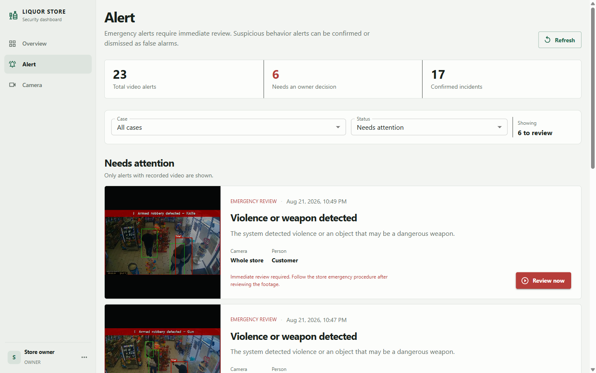
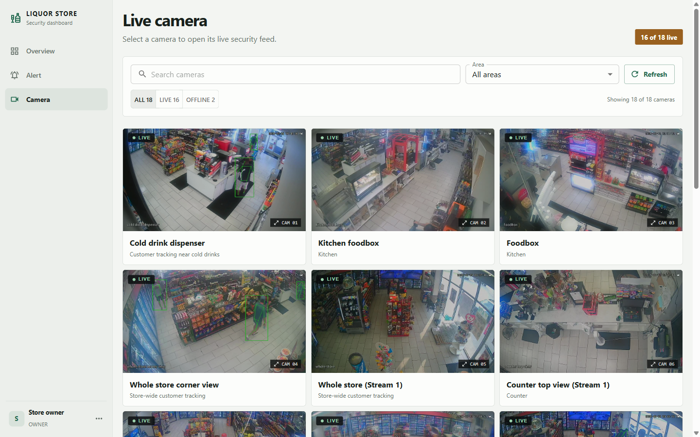

# Liquor Store Security

Video loss prevention for a single retail store. Turns CCTV recordings into
short reviewable clips, sends urgent ones to the owner over Telegram or
WhatsApp, and records the owner's decision on each alert.

The system reports events for a human to judge. It does not classify anyone as
a criminal and does not contact emergency services.

## Screenshots

| Overview | Alerts | Cameras |
|---|---|---|
|  |  |  |

## Features

- Owner dashboard with alert triage, camera grid and video review, in light and dark themes.
- Alert ingestion API for an external AI service, idempotent per source event.
- Emergency notifications over Telegram with WhatsApp fallback.
- Delivery worker with leases, retry, backoff, deduplication and an append-only attempt log.
- Expiring signed links for evidence playback; only the token hash is stored.
- Store-scoped RBAC, Argon2id password hashing and rotating refresh tokens.

## Tech stack

| Layer | Technology |
|---|---|
| Frontend | React 19, TypeScript, Vite, Material UI, TanStack Query |
| Backend | Go 1.26.8, `net/http`, pgx, JWT, Argon2id |
| Database | PostgreSQL with embedded SQL migrations |
| Providers | Telegram Bot API, WhatsApp Cloud API |
| Tracking | YOLO26n and ByteTrack, generated offline |

## Project structure

```
apps/
  api-go/          Go API, worker and migrations
  web/             React dashboard
docs/              Design documents, security audit, runbooks
scripts/           Go toolchain helpers, tracking generator
```

## Requirements

- Node.js and pnpm 11.9.0, pinned by `packageManager`.
- Go 1.26.8 or newer, enforced by `go.mod`. The helpers in `scripts/` accept a
  portable SDK at `.tools/go-1.26.8`.
- PostgreSQL 14 or newer.
- Git LFS. Sample clips are stored as LFS objects; without it a clone receives
  pointer files and video playback fails.

## Installation

```bash
git lfs install && git lfs pull
pnpm install
cp apps/api-go/.env.example apps/api-go/.env
pnpm db:migrate
pnpm db:seed
pnpm dev
```

| Service | URL |
|---|---|
| Dashboard | `http://localhost:5173` |
| API | `http://localhost:3000/api/v1` |
| Swagger UI | `http://localhost:3000/docs` |

Swagger is disabled when `NODE_ENV=production`.

## Configuration

Set values in `apps/api-go/.env`. The file is git-ignored and must stay that way.

| Variable | Purpose |
|---|---|
| `DATABASE_URL` | Pooled connection used at runtime |
| `DIRECT_URL` | Unpooled connection used for migrations |
| `JWT_ACCESS_SECRET` | Access token signing key |
| `WEB_ORIGIN` | Only origin accepted on state-changing requests |
| `TRUST_PROXY`, `TRUSTED_PROXY_CIDRS` | Forwarded headers are read only from these proxies |
| `AI_INGEST_TOKEN` | Bearer token for the alert ingestion route |
| `NOTIFICATION_WORKER_ENABLED` | Starts the delivery worker |
| `NOTIFICATION_CREDENTIAL_BINDINGS` | Store, provider and account each endpoint may use |
| `TELEGRAM_*`, `WHATSAPP_*` | Provider credentials and destinations |

`AI_INGEST_TOKEN` and `NOTIFICATION_WORKER_ENABLED` are unset by default. A
fresh checkout accepts no events and sends no messages.

## Scripts

| Command | Action |
|---|---|
| `pnpm dev` | Runs API and dashboard together |
| `pnpm build` | Builds both applications |
| `pnpm check` | Typecheck and vet |
| `pnpm db:migrate` | Applies migrations through `DIRECT_URL` |
| `pnpm db:seed` | Loads sample data, safe to repeat |

## API

| Method | Route | Purpose |
|---|---|---|
| `POST` | `/api/v1/auth/login` | Owner sign-in |
| `POST` | `/api/v1/auth/refresh` | Rotate refresh token |
| `GET` | `/api/v1/stores/{storeId}/alerts` | Alert queue |
| `POST` | `/api/v1/stores/{storeId}/alerts/{alertId}/resolve` | Confirm a real incident |
| `POST` | `/api/v1/stores/{storeId}/alerts/{alertId}/dismiss` | Mark a false alarm |
| `GET` | `/api/v1/stores/{storeId}/alerts/{alertId}/evidence/{evidenceId}/playback-url` | Signed playback URL |
| `GET` | `/api/v1/stores/{storeId}/cameras` | Camera list |
| `GET` | `/api/v1/stores/{storeId}/notification-deliveries` | Delivery audit |
| `POST` | `/api/v1/internal/ai/alerts` | Alert ingestion |
| `POST` | `/api/v1/webhooks/whatsapp` | Signed delivery receipts |
| `GET` | `/api/v1/notification-review/{token}` | Expiring evidence link |

Full contract in [docs/api-contract.md](docs/api-contract.md).

## Sample data

`pnpm db:seed` loads 18 camera feeds, 6 detection zones and 20 video-backed
alerts, with 12 alerts left in the review queue. Kitchen and Whole store top
view (Stream 2) start offline. Rows are matched by stable reference, so
repeated runs update rather than duplicate. `SEED_STORE_CODE` targets a
different store.

The dashboard opens on this sample data without a sign-in. Signing in at
`/login` switches it to the live API.

Bounding boxes arrive two ways. Most clips carry per-frame coordinates that the
browser draws during playback; regenerate them with
`scripts/generate-alert-tracks.py` after installing
`scripts/requirements-tracking.txt`. Emergency clips already have boxes rendered
into the frames, carry no tracking data, and are played untouched.

## Documentation

| Document | Contents |
|---|---|
| [Database design](docs/database-design.md) | Schema, relationships, retention |
| [API contract](docs/api-contract.md) | Endpoints, payloads, error shapes |
| [Authentication](docs/auth-design.md) | Sessions, refresh rotation, RBAC |
| [Notification design](docs/notification-design.md) | Outbox, worker, retry, fallback |
| [WhatsApp template](docs/whatsapp-emergency-template.md) | Template and parameters |
| [Notification runbook](docs/emergency-notification-production.md) | Production procedure and diagnosis |
| [Security hardening](docs/security-hardening.md) | Deployment checklist |
| [Security audit](docs/security-audit-2026-09-05.md) | Findings, 05/09/2026 |
| [Security fixes](docs/security-fixes-2026-09-05.md) | Patches and measured rollout |
| [Streaming design](docs/streaming-design.md) | Planned near-real-time ingest |

## Limitations

- WhatsApp delivery returns Meta error `131042`. The account's `health_status`
  attributes it to business verification rather than billing. See the runbook.
- Live RTSP ingest is designed but not implemented. The dashboard plays recorded
  footage only.
- Detection accuracy is not guaranteed. Every alert requires human review.
