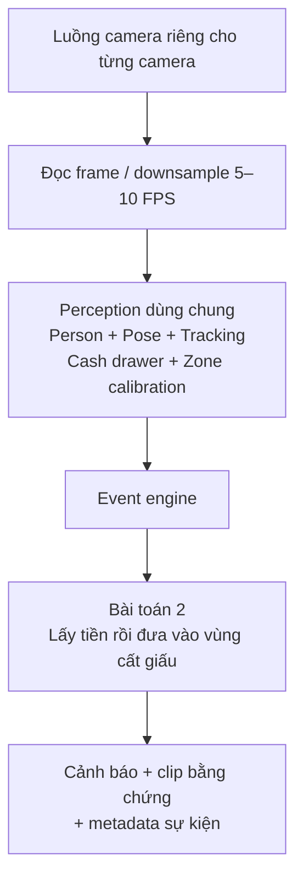
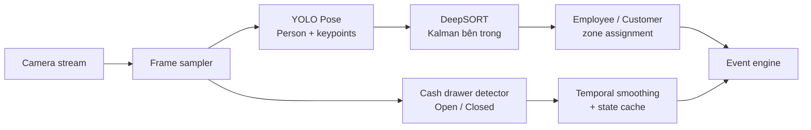
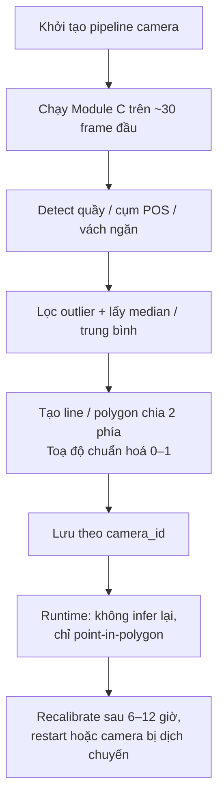
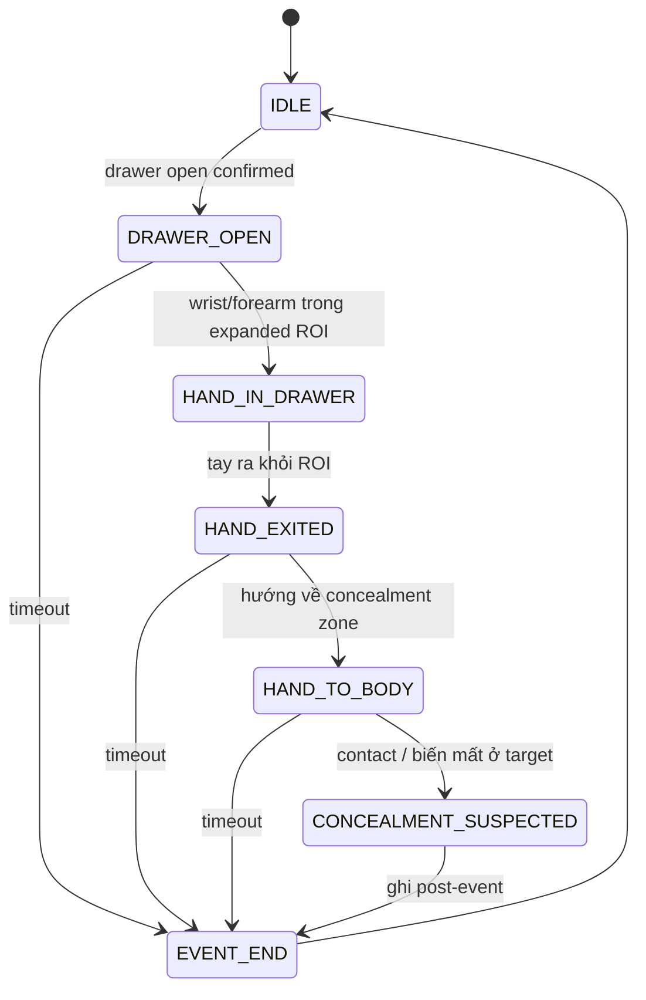
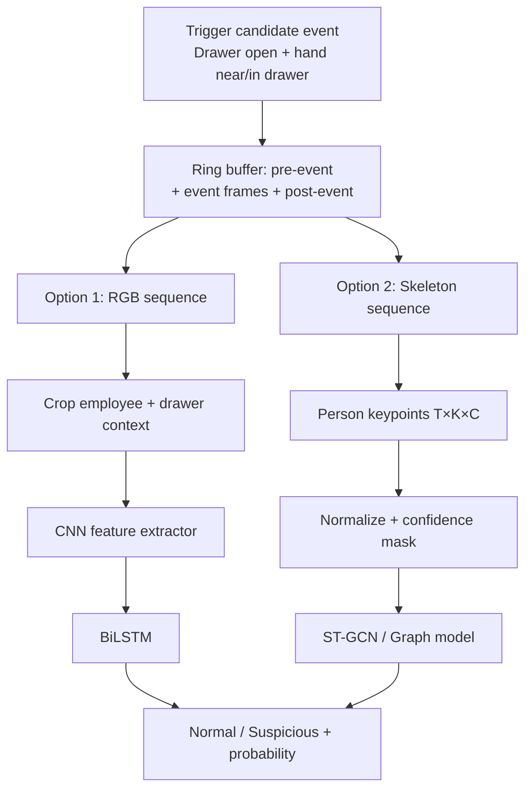
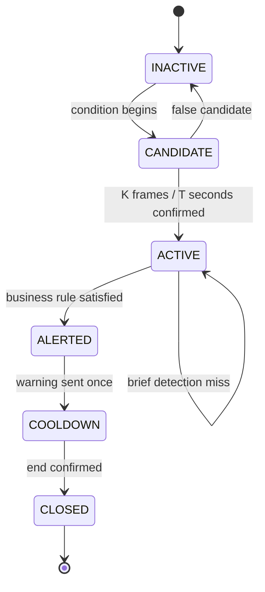

# Bài toán 2 — Phát hiện thất thoát tiền tại quầy thu ngân

Tài liệu mô tả bài toán, kiến trúc và hai hướng pipeline phát hiện.

**Phiên bản 1.3 — 08/2026.** Bài toán 1 (`SUSPICIOUS_DRAWER_OPEN`) đã **bỏ hoàn
toàn** khỏi phạm vi — xem [Phụ lục B](#phụ-lục-b-thay-đổi-so-với-v10). Tài liệu
này giờ chỉ đặc tả Bài toán 2 và tầng perception dùng chung mà nó cần.
Bản trước là v1.2, thay thế PDF v1.0
(`He_thong_phat_hien_nhan_vien_lay_trom_tien_tai_quay-20260804143525.pdf`).

Tài liệu này cũng là nơi đặc tả **tầng perception dùng chung** cho toàn hệ thống — frame
sampling, person detection, tracking, temporal state cache và event engine. Bài toán 3
(xâm phạm kho ngoài giờ, `02_kho_ngoai_gio.md`) dùng lại nguyên các mô-đun đó và chỉ mô
tả chúng ở mức tổng quan.

---

## 1. Tổng quan ở mức ứng dụng

Trong cửa hàng tiện lợi, thất thoát tiền không chỉ đến từ khách hàng mà còn có thể
phát sinh từ chính nhân viên. Nhân viên có quyền tiếp cận quầy thu ngân, hiểu quy
trình vận hành và có thể thực hiện hành vi bất thường trong những khoảng thời gian
khó quan sát. Hệ thống được đề xuất nhằm tự động phát hiện các sự kiện đáng nghi tại
khu vực quầy, lưu lại bằng chứng video và gửi cảnh báo để chủ cửa hàng kiểm tra.

Hệ thống **không tự kết luận trách nhiệm hình sự**. Kết quả đầu ra là một "sự kiện
nghi ngờ" kèm clip và metadata, phục vụ human review. Đây là cách tiếp cận phù hợp vì
một số thao tác hợp lệ của nhân viên có thể giống hành vi lấy trộm ở mức hình ảnh.

Giải pháp gồm hai lớp chính:

- **Lớp perception** — nhìn và theo dõi các đối tượng trong video.
- **Lớp event reasoning** — ghép các quan sát rời rạc thành một sự kiện có vòng đời.

Bài toán 2 được triển khai theo hai hướng song song: Pipeline A dựa trên rule và state
machine; Pipeline B dùng deep learning để phân loại chuỗi hành động.



## 2. Định nghĩa bài toán nghiệp vụ

| Bài toán | Mô tả nghiệp vụ | Đầu ra đề xuất | Mức độ |
|---|---|---|---|
| Bài 2 | Nhân viên đưa tay vào ngăn kéo, rút tay ra và đưa về túi quần, túi áo, túi xách hoặc vùng cất giấu. | `SUSPECTED_CASH_CONCEALMENT` | Cảnh báo rủi ro cao |

Phạm vi ban đầu tập trung vào camera cố định tại quầy thu ngân. Các hành vi như sửa
tiền, kiểm kê, đổi ca hoặc lấy tiền lẻ có thể tạo cảnh báo nhầm; do đó hệ thống phải
lưu đủ clip trước, trong và sau sự kiện để người vận hành đánh giá.

**Tình trạng khả thi.** Bài 2 cần vị trí cổ tay chính xác theo thời gian. Đo đạc trên
footage thật cho thấy không model pose công khai nào cho keypoint đủ chính xác ở góc
top-view này; chi tiết ở [11.2](#112-hạn-chế-chính). Điều này **không còn chặn việc
triển khai**: Pipeline A (rule-based FSM, [mục 6](#6-bài-toán-2--pipeline-a-rule-based-temporal-reasoning))
đã được code và chạy trong `ai/src/pipelines/counter_cash_theft.py`, bất kể Phase 2
(chốt model perception) chưa xong — xem ghi chú rủi ro ở
[11.2](#112-hạn-chế-chính) và [Phụ lục D](#phụ-lục-d-trạng-thái-triển-khai). Nghĩa là
độ chính xác vị trí cổ tay của cảnh báo hiện tại chưa được đảm bảo bởi tầng perception,
dù logic state machine phía trên đúng đặc tả.

## 3. Kiến trúc tổng thể theo từng camera

Mỗi luồng camera có một pipeline riêng, một bộ trạng thái riêng và một vùng cấu hình
riêng. Điều này giúp tránh lẫn Track ID, trạng thái ngăn kéo và sự kiện giữa các
camera. Camera khác góc, khác độ phân giải hoặc khác layout vẫn được xử lý độc lập.



```
CameraPipeline(camera_id)
├── FrameSampler
├── PersonPoseDetector
├── MultiObjectTracker          <- uae_tracker.py
├── ZoneCalibration / RoleAssignment
├── CashDrawerStateDetector
├── TemporalStateCache
├── Problem1EventEngine
├── Problem2PipelineA
├── Problem2PipelineB (optional)
└── EvidenceRecorder + AlertPublisher
```

Mỗi pipeline giữ ring buffer video riêng để có thể lấy lại vài giây hình ảnh trước khi
trigger xảy ra. Khi một event được tạo, clip bằng chứng gồm pre-event, phần chính của
hành vi và post-event.

**Cô lập theo camera.** Bộ đếm Track ID thuộc về từng instance `Tracker`, không phải
biến class dùng chung toàn process. Mỗi camera đếm từ 1 và dãy ID tái lập được khi chạy
lại cùng một video, độc lập với việc các camera khác đang bận hay rảnh. Khi cần định
danh toàn cục thì ghép `f"{camera_id}:{track_id}"`.

## 4. Các mô-đun dùng chung

### 4.1. Video ingestion và frame sampling

Input là luồng RTSP hoặc video frame từ camera. Hệ thống có thể downsample xuống 5–10
FPS để giảm chi phí. Với Bài 2, chuyển động tay có thể nhanh nên nên hỗ trợ adaptive
FPS: chạy nền ở 5 FPS và tăng lên 10–15 FPS khi drawer bắt đầu mở. Adaptive FPS lên 15
chỉ khả thi nếu detector chạy dưới ~50 ms mỗi frame; cần kiểm tra lại sau khi chốt
model perception ([Phase 2](#113-lộ-trình-triển-khai-đề-xuất)).

**Kích thước input của model.** Graph ONNX export mặc định có input cố định `640×640`.
Ảnh camera 1920×1080 khi letterbox vuông sẽ bị pad thêm 280 dòng xám không mang thông
tin, tức tốn 1.67× số pixel cho cùng lượng nội dung. Nên export ở `imgsz=(384, 640)`:
tỉ lệ thu nhỏ giữ nguyên (r = 1/3) nên vật thể không nhỏ đi và chất lượng detect không
đổi, nhưng tiết kiệm khoảng 40% thời gian inference. Lưu ý Ultralytics khi chạy `.pt`
đã tự letterbox chữ nhật theo cách này; chỉ graph ONNX mới bị buộc vuông.

Sampler chạy trên thread riêng, pace theo wall clock và **drop frame khi consumer chưa
kịp** — đúng hành vi của một luồng RTSP thật dưới backpressure, thay vì dồn ứ buffer rồi
xử lý dữ liệu đã cũ.

| Trường | Kiểu | Ví dụ | Ý nghĩa |
|---|---|---|---|
| `camera_id` | string | `GNG23_counter_top` | Định danh pipeline |
| `timestamp_ms` | int64 | 1722701234123 | Thời gian frame |
| `frame_index` | int64 | 15420 | Chỉ số frame |
| `image` | uint8 H×W×3 | 1920×1080×3 | Ảnh BGR/RGB |

### 4.2. Person, pose estimation và tracking

YOLO Pose cung cấp person bounding box và body keypoints. DeepSORT duy trì Track ID
giữa các frame; Kalman filter bên trong tracker dự đoán vị trí tạm thời khi person bị
miss trong một số frame.

```
PersonTrack {
  track_id: int,
  bbox_xyxy: [x1, y1, x2, y2],
  bbox_source: "detected" | "predicted",
  keypoints: K x [x, y, confidence],
  role: "employee" | "customer" | "unknown",
  last_seen_ms: int64,
  time_since_update: int
}
```

#### 4.2.1. Pose phải đi theo association, không ghép lại sau

Keypoints được gắn vào `Detection` **trước khi** đưa vào tracker, và `Track` lưu lại
pose của đúng detection mà bộ matcher đã ghép cho nó. Liên kết wrist ↔ track_id vì thế
là liên kết do chính bài toán association quyết định.

Tuyệt đối **không** khôi phục liên kết này ở tầng dưới bằng cách so khoảng cách bbox
giữa track và detection. Cách đó có hai điểm hỏng: box của track là box đã qua Kalman
nên không trùng box detection; và khi hai người đứng sát nhau sau quầy, phép "box gần
nhất" có thể gán cổ tay của người này cho ID của người kia. Vẽ sai một frame thì không
ai thấy, nhưng Bài 2 quyết định `active_hand` dựa trên chính cổ tay đó — gán nhầm actor
là hỏng cả sự kiện.

#### 4.2.2. Lịch sử cổ tay, tách trái/phải

Các feature của Bài 2 (`d_hand_drawer(t)`, `d_hand_target(t)`, velocity, direction
cosine, dwell time — xem [6.3](#63-phát-hiện-quỹ-đạo-từ-drawer-về-vùng-cất-giấu)) đều là
hàm theo thời gian, không tính được từ một frame đơn lẻ. Quỹ đạo bbox toàn thân không
thay thế được: người đứng yên đút tiền vào túi có bbox gần như bất động trong khi cổ tay
đi cả một đoạn.

Mỗi track vì thế giữ hai deque riêng cho hai tay:

```
wrist_l, wrist_r : deque[(frame, x, y, conf, valid)]   # dài HAND_TRAJ_S giây
valid = conf >= WRIST_CONF_TH
```

Ba quy tắc:

- **Tách trái/phải.** Một tay có thể lấy tiền trong khi tay kia đóng ngăn kéo; gộp
  chung cho ra quỹ đạo vô nghĩa.
- **Ghi kèm cờ `valid`, không nội suy.** Khi cổ tay bị thân che, YOLO vẫn trả toạ độ
  nhưng confidence thấp và toạ độ là rác. Ghi thẳng vào lịch sử sẽ tạo velocity giả.
  Rule phải phân biệt được "tay ở chỗ khác" với "tay không nhìn thấy".
- **Mỗi mẫu mang số frame của chính nó.** Frame mà track không được quan sát thì không
  để lại mẫu, nên khoảng trống hiện ra dưới dạng bước nhảy trong dãy frame. Không cần
  mảng mask song song.

Đây cũng chính là `valid_mask` mà Pipeline B cần ở [7.1](#71-cơ-chế-tạo-sequence) — làm
một lần, dùng cho cả hai pipeline.

#### 4.2.3. Track đang coasting vẫn phải được báo lên

Tracker trả về track kèm nguồn gốc của box:

| Trạng thái | `bbox_source` | Ý nghĩa với event layer |
|---|---|---|
| ACTIVE (có detection frame này) | `detected` | Bằng chứng đầy đủ, được phép kích hoạt chuyển state |
| LOST, trong `person_grace` | `predicted` | Chỉ được phép **giữ** event sống, không kích hoạt state mới |
| LOST, quá `person_grace` | không báo | Coi như vắng mặt |

Lý do: một track miss một frame **không hề biến mất** — nó vẫn nằm trong tracker và
Kalman vẫn đang dự đoán cho nó. Nếu chỉ báo lên các track được quan sát, actor sẽ chớp
tắt chỉ vì một detection hụt và cắt đôi sự kiện đang diễn ra. Đo trên `cctv_test.mp4`
(1100 frame, 10 FPS): trung bình **1.64 track-frame mỗi frame** rơi vào trạng thái
`predicted` — tức lượng thông tin bị giấu đi là đáng kể, không phải trường hợp hiếm.

### 4.3. Module C — Phân chia phía nhân viên và phía khách hàng

Module C không cần chạy ở mọi frame. Khi pipeline của một camera khởi tạo, module chạy
trên khoảng 30 frame đầu, detect cụm quầy/POS/vách ngăn, loại bỏ outlier rồi lấy median
hoặc trung bình để tạo đường hoặc polygon phân chia. Kết quả được lưu theo `camera_id`
bằng toạ độ chuẩn hoá 0–1.



Trong runtime, hệ thống chỉ lấy bottom-center của person bbox hoặc hip center rồi thực
hiện point-in-polygon để gán employee/customer. Module được recalibrate sau 6–12 giờ,
khi pipeline restart hoặc khi phát hiện camera bị dịch chuyển.

Với MVP, có thể bỏ qua phần tự động detect và đọc thẳng polygon từ file cấu hình
([9.1](#91-input-cấu-hình-camera)); phần calibration tự động bổ sung sau.

### 4.4. Cash drawer state detection

Model xác định ngăn kéo ở trạng thái OPEN hoặc CLOSED. Với camera cố định, có thể crop
ROI ngăn kéo và dùng classifier; nếu vị trí thay đổi nhiều, dùng detector. Đầu ra cần
gồm class, confidence và bbox. Khi detector miss, hệ thống giữ bbox hợp lệ gần nhất
trong grace period thay vì reset ngay.

```
CashDrawerObservation {
  state: "open" | "closed" | "unknown",
  confidence: float,
  bbox_xyxy: [x1, y1, x2, y2] | null,
  bbox_source: "detected" | "cached",
  last_detected_ms: int64
}
```

### 4.5. Temporal smoothing và state cache

Prediction từng frame không được dùng trực tiếp để bắn cảnh báo. Hệ thống xác nhận
trạng thái bằng K frame liên tiếp hoặc thời lượng T giây. Khi có miss ngắn, giữ trạng
thái cũ. Khi miss kéo dài quá timeout, chuyển sang unknown hoặc đóng trạng thái theo
quy tắc an toàn.

## 5. (Đã bỏ) Bài toán 1: Mở ngăn kéo bất thường

Bài toán 1 (`SUSPICIOUS_DRAWER_OPEN` — mở ngăn kéo khi không có khách) đã bị loại khỏi
phạm vi dự án, xem [Phụ lục B](#phụ-lục-b-thay-đổi-so-với-v10). Đặc tả cũ không còn giữ
ở đây; nếu cần tham khảo, xem lịch sử git của file này trước commit đổi sang v1.3.

## 6. Bài toán 2 — Pipeline A: Rule-based temporal reasoning

Pipeline A kết hợp deep learning ở tầng perception với rule-based reasoning ở tầng
nghiệp vụ. Điểm khó không nằm ở một model duy nhất mà ở việc duy trì đúng actor, đúng
tay, đúng thứ tự hành động và chịu được miss detection.

### 6.1. Các trạng thái chính



| State | Ý nghĩa | Điều kiện vào | Điều kiện thoát |
|---|---|---|---|
| `IDLE` | Không có sự kiện | Mặc định | Drawer open confirmed |
| `DRAWER_OPEN` | Ngăn kéo đã mở | Open ổn định K frame / T giây | Tay vào drawer hoặc timeout |
| `HAND_IN_DRAWER` | Một tay cụ thể đã tương tác drawer | Wrist/forearm nằm trong expanded ROI | Tay ra khỏi ROI |
| `HAND_EXITED` | Tay đã rút khỏi drawer | Outside xác nhận nhiều frame | Đi về concealment zone hoặc timeout |
| `HAND_TO_BODY` | Tay di chuyển về cơ thể/túi/bag | Khoảng cách tới target giảm, hướng phù hợp | Contact/disappear hoặc timeout |
| `CONCEALMENT_SUSPECTED` | Chuỗi đáng nghi hoàn thành | Tay chạm/biến mất ở vùng cất giấu | Ghi post-event rồi đóng |
| `EVENT_END` | Sự kiện kết thúc | Timeout hoặc hoàn thành | Reset về IDLE |

### 6.2. Xác định tay tương tác với ngăn kéo

Không nên chỉ kiểm tra cổ tay nằm trong bbox drawer. Nên dùng expanded drawer ROI, giao
cắt của đoạn elbow–wrist với ROI, khoảng cách tới polygon và confidence keypoint. Khi
một tay được xác nhận là `active_hand`, mọi bước sau phải theo đúng tay đó.

```python
hand_in_drawer = (
    wrist_conf >= CONF_TH
    and (
        point_in_polygon(wrist, expanded_drawer_roi)
        or segment_intersects(elbow, wrist, drawer_roi)
        or distance(wrist, drawer_roi) <= DIST_TH
    )
)
```

Điều kiện `wrist_conf >= CONF_TH` chính là cờ `valid` trong lịch sử cổ tay
([4.2.2](#422-lịch-sử-cổ-tay-tách-tráiphải)). Không được xác nhận `HAND_IN_DRAWER` từ một
mẫu `valid = False`.

### 6.3. Phát hiện quỹ đạo từ drawer về vùng cất giấu

Sau khi `active_hand` rời drawer, hệ thống theo dõi quỹ đạo trong một cửa sổ thời gian.
Một trajectory đáng nghi thường có khoảng cách tới drawer tăng, đồng thời khoảng cách
tới hip/chest/pocket/bag giảm. Có thể bổ sung góc chuyển động, vận tốc và thời gian lưu
tại target zone.

| Feature | Mô tả | Dùng để |
|---|---|---|
| `d_hand_drawer(t)` | Khoảng cách tay tới drawer | Xác nhận rời drawer |
| `d_hand_target(t)` | Khoảng cách tay tới pocket/chest/bag | Xác nhận tiến về vùng cất giấu |
| `velocity` | Vận tốc cổ tay | Phân biệt đứng yên và rút nhanh |
| `direction cosine` | Mức cùng hướng với vector drawer→target | Đánh giá hướng |
| `dwell time` | Thời gian tay ở target zone | Tăng độ tin cậy |
| `occlusion after entry` | Pose tay mất sau khi vào target zone | Tín hiệu hỗ trợ, không dùng độc lập |

Tất cả đều đọc từ deque cổ tay, so mẫu hiện tại với mẫu cách đây k frame, bỏ qua các
mẫu `valid = False`:

```python
def moves_to_concealment(track, side, k=5):
    hist = [s for s in track.wrist(side) if s.valid][-(k + 1):]
    if len(hist) < k + 1:
        return False
    now, past = hist[-1], hist[0]
    return (dist(now, drawer) > dist(past, drawer)
            and dist(now, target) < dist(past, target))
```

### 6.4. Concealment zones

Vùng cất giấu có thể tạo tương đối từ pose: pocket trái/phải quanh hip và phần trên của
thigh; chest/shirt giữa shoulder và hip; waist quanh hai hip. Túi xách hoặc túi đeo chéo
nên có detector riêng hoặc class bag. Các vùng này phải scale theo kích thước person
bbox để dùng được cho người ở gần hoặc xa camera.

### 6.5. Pseudocode rút gọn

```
for each frame:
  update_person_tracks()          # trả về (track, bbox_source)
  update_drawer_state_with_cache()

  for each employee_track:
    event = get_event(employee_track.id)

    if bbox_source == "predicted":
      keep_event_alive(event)     # giữ sống, không xét chuyển state
      continue

    if event.state == IDLE and drawer_open_confirmed():
        event.state = DRAWER_OPEN

    elif event.state == DRAWER_OPEN:
        if left_hand_in_drawer_confirmed():
            event.active_hand = LEFT
            event.state = HAND_IN_DRAWER
        elif right_hand_in_drawer_confirmed():
            event.active_hand = RIGHT
            event.state = HAND_IN_DRAWER

    elif event.state == HAND_IN_DRAWER:
        if active_hand_exit_confirmed():
            event.state = HAND_EXITED
        elif temporary_miss():
            keep_event_alive()

    elif event.state == HAND_EXITED:
        if active_hand_moves_to_concealment_zone():
            event.state = HAND_TO_BODY

    elif event.state == HAND_TO_BODY:
        if hand_contacts_or_disappears_in_target():
            event.state = CONCEALMENT_SUSPECTED
            publish_warning_once(event)
```

## 7. Bài toán 2 — Pipeline B: Deep learning sequence classification

Pipeline B nhận một chuỗi hành động và học trực tiếp mẫu chuyển động "bình thường" hoặc
"đáng nghi". Trigger vẫn nên đến từ drawer open + hand interaction để giảm số sequence
cần infer và tập trung model vào đoạn có khả năng chứa hành vi.



### 7.1. Cơ chế tạo sequence

Mỗi camera giữ ring buffer. Khi trigger xuất hiện, sequence lấy thêm 2–3 giây pre-event,
toàn bộ giai đoạn tương tác và 3–5 giây post-event. Với FPS mục tiêu 10, sequence 6 giây
có 60 timestep. Có thể pad, truncate hoặc resample về chiều dài cố định T.

```
SequenceWindow {
  event_id: string,
  camera_id: string,
  employee_track_id: int,
  start_ms: int64,
  end_ms: int64,
  fps: float,
  valid_mask: [T],
  source: "rgb" | "skeleton"
}
```

`valid_mask` lấy trực tiếp từ cờ `valid` của lịch sử cổ tay và của keypoints nói chung
([4.2.2](#422-lịch-sử-cổ-tay-tách-tráiphải)), không tính lại.

### 7.2. Option 1 — Cropped person sequence → CNN → BiLSTM → classify

Mỗi frame được crop theo union box của employee và drawer, thêm margin để giữ context.
Không nên crop sát person vì model cần nhìn thấy quan hệ tay–drawer–cơ thể. CNN nhỏ
trích xuất một feature vector cho từng frame; chuỗi feature được đưa qua BiLSTM để phân
loại.

```
Input RGB:
  X_rgb shape = [B, T, C, H, W]     ví dụ [8, 60, 3, 224, 224]
Per-frame CNN:
  F shape     = [B, T, D]           ví dụ [8, 60, 512]
BiLSTM output:
  logits shape = [B, num_classes]
  probability  = softmax(logits)
```

Backbone phù hợp cho MVP gồm ResNet18, MobileNetV3 hoặc EfficientNet-B0. InceptionV3
dùng được nhưng tương đối nặng. Có thể freeze backbone giai đoạn đầu, sau đó fine-tune
một phần khi có đủ dữ liệu.

| Ưu điểm | Hạn chế |
|---|---|
| Nhìn được context, túi xách, quần áo và vật thể nhỏ nếu đủ rõ | Cần nhiều dữ liệu, nhạy với góc camera và ánh sáng |
| Có khả năng học pattern ngoài skeleton | Chi phí inference lớn hơn; crop sai sẽ làm mất context |
| Dễ bổ sung các class hành động mới | Khó giải thích hơn rule-based |

### 7.3. Option 2 — Sequence keypoints → Graph/ST-GCN → classify

Mỗi frame được biểu diễn bằng skeleton của employee. Các joint là node; liên kết giải
phẫu là edge; chuỗi theo thời gian tạo thành spatio-temporal graph. ST-GCN học đồng thời
quan hệ giữa các khớp và sự thay đổi qua thời gian.

```
Input skeleton:
  X_pose shape = [B, C, T, V, M]    ví dụ [8, 3, 60, 17, 1]
  B: batch size
  C: channels, thường [x, y, confidence] hoặc [x, y, score, velocity]
  T: số timestep
  V: số keypoints
  M: số người, ở đây thường M = 1
```

Trước khi đưa vào graph cần normalize toạ độ theo person bbox hoặc torso size, đưa
origin về hip/torso center, giữ confidence mask và có thể thêm các node context như
drawer center, left/right pocket target. Việc bổ sung context node giúp graph hiểu quan
hệ giữa tay và drawer thay vì chỉ hiểu skeleton.

| Ưu điểm | Hạn chế |
|---|---|
| Nhẹ, ít phụ thuộc màu sắc và background | Pose top-view bị quầy che có thể nhiễu |
| Tập trung tốt vào motion pattern | Không nhìn thấy tiền hoặc chi tiết vật thể |
| Dễ chuẩn hoá giữa nhiều camera | Khó phân biệt tay vào túi để giấu tiền với chỉnh quần áo nếu skeleton giống nhau |

### 7.4. So sánh hai option

| Tiêu chí | CNN + BiLSTM | ST-GCN |
|---|---|---|
| Đầu vào | Chuỗi crop RGB có context | Chuỗi keypoints đã normalize |
| Chi phí | Trung bình–cao | Thấp–trung bình |
| Nhu cầu dữ liệu | Cao hơn | Thấp hơn nhưng cần pose ổn định |
| Khả năng nhìn túi/vật thể | Tốt hơn | Hạn chế |
| Khả năng chịu thay đổi background | Kém hơn | Tốt hơn |
| Khả năng giải thích | Trung bình | Trung bình |
| Khuyến nghị | Dùng khi cần context hình ảnh | Dùng làm baseline nhẹ / motion model |

Hướng thực tế nên triển khai cả hai theo thứ tự: trước hết xây baseline ST-GCN hoặc
BiLSTM trên keypoints để kiểm chứng dữ liệu; sau đó huấn luyện CNN+BiLSTM nếu skeleton
không đủ phân biệt. Ở phiên bản nâng cao có thể fusion pose feature, RGB feature và
business context rồi đưa qua classifier cuối.

### 7.5. Output model

```
ActionClassification {
  event_id: string,
  label: "normal_drawer_interaction" | "suspected_concealment",
  probability: float,
  model_version: string,
  window_start_ms: int64,
  window_end_ms: int64,
  quality_flags: ["pose_missing", "crop_occluded", ...]
}
```

## 8. Event engine và cơ chế chống cảnh báo lặp

Đơn vị quản lý là event, không phải frame. Event có start time, actor, current state,
evidence, last update và end time. Khi điều kiện vẫn kéo dài, hệ thống chỉ update event
hiện tại; không phát cảnh báo mới ở mỗi frame.



```
EventRecord {
  event_id: string,
  camera_id: string,
  event_type: string,
  employee_track_id: int | null,
  state: string,
  severity: "low" | "medium" | "high",
  start_ms: int64,
  last_update_ms: int64,
  end_ms: int64 | null,
  warning_sent: bool,
  evidence_frames: [FrameRef],
  clip_uri: string | null,
  metadata: object
}
```

Nên cấu hình thời gian thay vì chỉ dùng số frame, vì FPS thực tế có thể thay đổi. Ví dụ
`open_confirmation` = 0.3 giây, `drawer_grace` = 1.5 giây, `person_grace` = 1.0 giây,
`pose_grace` = 0.5 giây, `hand_exit_confirmation` = 0.2–0.4 giây và `post_event` = 3 giây.

**Chống cảnh báo lặp khi actor đổi ID.** Hệ thống không duy trì re-identification
gallery: một track mất quá `max_age` thì bị REMOVED và ID không quay lại
([Phụ lục C](#phụ-lục-c-mô-hình-định-danh-của-tracker)). Người xuất hiện lại sau đó là một
actor mới, event cũ timeout và đóng. Hệ quả cần chấp nhận: một hành vi kéo dài bị cắt
bởi occlusion dài có thể sinh hai event. Biện pháp chặn ở tầng event là `event_cooldown`
cấp camera (3–10 giây): event mới sinh ra ngay sau khi event cùng loại vừa đóng trên
cùng camera sẽ bị nuốt, không cần biết có phải cùng người hay không.

## 9. Định dạng dữ liệu vào/ra

### 9.1. Input cấu hình camera

```json
{
  "camera_id": "GNG23_counter_top",
  "stream_url": "rtsp://...",
  "target_fps": 10,
  "recalibration_hours": 6,
  "zones": {
    "employee_polygon_norm": [[0.05,0.30],[0.55,0.25],[0.58,0.95],[0.03,0.95]],
    "customer_polygon_norm": [[0.55,0.20],[0.98,0.18],[0.98,0.95],[0.58,0.95]],
    "checkout_polygon_norm": [[0.55,0.20],[0.90,0.20],[0.90,0.75],[0.58,0.75]],
    "drawer_roi_norm": [0.42,0.32,0.58,0.48]
  }
}
```

### 9.2. Frame-level inference output

```json
{
  "camera_id": "GNG23_counter_top",
  "timestamp_ms": 1722701234123,
  "persons": [
    {
      "track_id": 7,
      "bbox_xyxy": [410,220,610,880],
      "bbox_source": "detected",
      "role": "employee",
      "keypoints": [[410,225,0.93]]
    }
  ],
  "drawer": {
    "state": "open",
    "confidence": 0.91,
    "bbox_xyxy": [512,321,658,409],
    "bbox_source": "detected"
  }
}
```

### 9.3. Event-level output

```json
{
  "event_id": "GNG23_20260803_000127",
  "camera_id": "GNG23_counter_top",
  "event_type": "SUSPECTED_CASH_CONCEALMENT",
  "severity": "high",
  "employee_track_id": 7,
  "start_time": "2026-08-03T22:31:05.120+07:00",
  "end_time": "2026-08-03T22:31:14.740+07:00",
  "warning_sent": true,
  "reason_codes": [
    "DRAWER_OPEN_CONFIRMED",
    "RIGHT_HAND_IN_DRAWER",
    "HAND_EXIT_TO_RIGHT_POCKET",
    "HAND_OCCLUDED_IN_TARGET_ZONE"
  ],
  "rule_score": 0.86,
  "dl_probability": 0.78,
  "clip_uri": "s3://evidence/...mp4"
}
```

## 10. Xử lý miss detection và các trường hợp biên

| Tình huống | Cách xử lý | Nguyên tắc |
|---|---|---|
| Miss person vài frame | Giữ Track ID và bbox dự đoán từ Kalman nếu track còn alive; báo lên với `bbox_source = "predicted"` | Prediction chỉ duy trì event, không tạo bằng chứng mới mạnh |
| Miss pose tay | Giữ trajectory ngắn hạn; mẫu vẫn được ghi nhưng `valid = False`; chờ pose xuất hiện lại trong `pose_grace` | Không xác nhận `HAND_IN_DRAWER` chỉ từ wrist dự đoán |
| Miss cash drawer | Dùng bbox hợp lệ gần nhất và giữ state trong `drawer_grace` | Bbox cached có timeout; không giữ vô hạn |
| Drawer đóng trước khi tay rút | Sau `HAND_IN_DRAWER` vẫn theo `active_hand` dù drawer đã closed | Drawer là trigger/context, không phải điều kiện bắt buộc ở mọi state |
| Tay trái đóng, tay phải lấy | Lưu `active_hand` riêng trái/phải, hai deque quỹ đạo tách biệt | Không trộn trajectory hai tay |
| Person đổi ID | Không re-associate. Track mất quá `max_age` thì event đóng; track mới là actor mới | Chấp nhận đánh đổi; chống cảnh báo dội bằng `event_cooldown` cấp camera |
| Nhiều nhân viên tại quầy | Mỗi track có event state riêng; chọn người có hand interaction | Actor phải gắn với track cụ thể |
| Nhân viên lấy tiền hợp lệ | Vẫn có thể cảnh báo; clip được human review | Ưu tiên recall theo nghiệp vụ, không tự kết tội |

## 11. Đánh giá, hạn chế và lộ trình triển khai

### 11.1. Chỉ số đánh giá

| Nhóm | Chỉ số |
|---|---|
| Perception | Person recall, pose keypoint quality, drawer open/closed F1, tracking IDF1 |
| Event detection | Event recall, event precision, false alerts per camera-hour, duplicate-alert rate |
| Timing | Time-to-alert, event start/end error, clip completeness |
| System | FPS, GPU utilization, latency, uptime, memory per camera |
| Business | Tỷ lệ cảnh báo được reviewer xác nhận, thời gian review tiết kiệm |

### 11.2. Hạn chế chính

Tiền là vật thể nhỏ và thường bị che; hành động hợp lệ có thể giống hành vi cất giấu;
layout quầy khác nhau làm thay đổi ROI; bag/pocket không luôn nhìn rõ. Vì vậy đầu ra
nên được diễn giải là "suspected event", không phải kết luận cuối cùng.

**Hạn chế nghiêm trọng nhất là chất lượng pose ở góc top-view.** Bản v1.0 ghi rằng pose
top-view "có thể không ổn định"; sau khi đo trên footage thật, điều này không còn là
phỏng đoán mà là một rào chặn xác định.

Kết quả đo trên các model pose công khai hiện có, ở đúng góc camera này:

- **Detection thiếu nghiêm trọng.** Model tốt nhất tìm được khoảng 17/20 người; phần lớn
  các model chỉ đạt 3–11/20. Người đứng rõ ràng trong khung vẫn bị bỏ sót hoàn toàn.
- **Keypoint sai ở mọi model.** Kể cả khi bounding box đặt đúng người, khung xương vẫn là
  các đoạn nối gần như ngẫu nhiên; cổ tay và mắt cá chân bị đặt lệch hàng trăm pixel.
- **Sai một cách tự tin.** Các keypoint sai đó vẫn mang confidence 0.90–1.00. Đây là
  "confidently wrong", không phải "uncertain" — nên **không thể lọc bằng ngưỡng**, và
  cũng không thể dùng keypoint confidence làm tín hiệu phụ để bù recall.
- **Không phải vấn đề dung lượng model.** Model lớn hơn không cải thiện đều: trong một họ
  model, bản lớn nhất còn kém bản trung bình. Nguyên nhân là lệch domain — COCO gần như
  không có ảnh chụp thẳng từ trên xuống.
- **Kiến trúc bottom-up không cứu được.** Giả thuyết rằng model một giai đoạn (không cần
  detector) sẽ vượt qua nút thắt đã được thử và bác bỏ: chậm hơn, không bắt được nhiều
  người hơn, và sinh box trùng trên cùng một người.
- **Model top-down không áp dụng được.** Chúng cần bounding box từ một detector chạy
  trước, mà nút thắt nằm chính ở bước detect.
- **Model chuyên fisheye không phù hợp.** Các công trình top-view công khai đều huấn luyện
  trên fisheye tròn 180°, nơi người bị xoay theo phương bán kính quanh tâm ảnh. Camera
  này là ống kính góc rộng gần thẳng đứng, không có đặc tính đó.

Hệ quả trực tiếp: **Bài 2 không thể triển khai trên tầng perception hiện tại.** Bài 1
không bị ảnh hưởng vì chỉ cần bounding box.

Ngoài ra, việc không có re-identification gallery nghĩa là hành vi bị occlusion dài hơn
`max_age` sẽ bị cắt thành hai event; đây là đánh đổi có chủ ý, xem
[Phụ lục C](#phụ-lục-c-mô-hình-định-danh-của-tracker).

### 11.3. Lộ trình triển khai đề xuất

Thứ tự đã thay đổi so với v1.0. Việc chốt model perception được tách thành một phase
riêng và đẩy lên **trước** Pipeline A, vì không thể xây FSM bám theo cổ tay trên một
tầng pose chưa cho được cổ tay đúng ([11.2](#112-hạn-chế-chính)).

| Giai đoạn | Phạm vi | Mục tiêu | Trạng thái |
|---|---|---|---|
| Phase 1 | Module dùng chung | Ổn định stream, zone, drawer state, event deduplication | Phần lớn xong, event dedup còn thiếu — xem [Phụ lục D](#phụ-lục-d-trạng-thái-triển-khai) |
| Phase 2 | Chốt model perception | Quyết định góc camera; nếu giữ top-down thì fine-tune pose model trên footage thật. Điều kiện tiên quyết lý tưởng của Bài 2. | Chưa bắt đầu — **nhưng Phase 3 đã triển khai trước, xem ghi chú rủi ro dưới đây** |
| Phase 3 | Pipeline A cho Bài 2 | Xây FSM, `active_hand`, trajectory và evidence clip | **Đã code** (`ai/src/pipelines/counter_cash_theft.py`, `ai/src/perception/problem2_fsm.py`) — độ tin cậy vị trí cổ tay chưa được Phase 2 xác nhận; còn thiếu 3 điểm đặc tả, xem [Phụ lục D](#phụ-lục-d-trạng-thái-triển-khai) |
| Phase 4 | Thu thập/label sequence hành vi | Tạo taxonomy normal/suspicious và bộ dữ liệu đa camera | Chưa bắt đầu |
| Phase 5 | Pipeline B baseline | So sánh ST-GCN với CNN+BiLSTM | Chưa bắt đầu |
| Phase 6 | Fusion + deployment | Kết hợp rule score và DL probability; tối ưu latency | Chưa bắt đầu |
| Phase 7 | Human-in-the-loop | Feedback reviewer để điều chỉnh threshold và tái huấn luyện | Chưa bắt đầu |

**Rủi ro đã chấp nhận (không phải sai sót thầm lặng):** Phase 3 được triển khai trước
Phase 2 hoàn tất. Nghĩa là Pipeline A đang chạy trên một tầng pose mà chính tài liệu
này đo và kết luận là chưa đạt ở góc top-down ([11.2](#112-hạn-chế-chính)). Logic state
machine đúng đặc tả không bù được keypoint sai vị trí nhưng confidence cao
("confidently wrong"). Quyết định này cần được ghi nhận tường minh, không để ai đọc
Phase 3 = "Đã code" rồi hiểu nhầm là đã qua Phase 2.

### 11.4. Khuyến nghị kiến trúc sản phẩm

**Quyết định cần chốt trước tiên: góc camera.** Nếu camera có thể hạ xuống góc nghiêng
thay vì gần thẳng đứng, mọi model pose công khai sẽ hoạt động ngay và bỏ được toàn bộ
giai đoạn gán nhãn cùng fine-tune. Chi phí đổi vị trí camera gần như chắc chắn thấp hơn
chi phí xây một bộ dữ liệu có nhãn keypoint. Chỉ khi bắt buộc giữ góc top-down mới nên
đi hướng fine-tune, và khi đó cách rẻ nhất là dùng model detection mạnh nhất để sinh
nhãn bounding box thô, sửa tay phần keypoint trên vài trăm frame, rồi fine-tune một
model nhỏ để lấy lại ngân sách tốc độ.

Bản đầu tiên nên dùng Bài 1 và Pipeline A làm lõi vì dễ giải thích, dễ kiểm soát recall
và ít phụ thuộc dữ liệu huấn luyện. Pipeline B đóng vai trò model chấm điểm bổ sung, ưu
tiên clip cần review hoặc giảm false positive. Khi dữ liệu đủ lớn, có thể chuyển sang
fusion model nhưng vẫn giữ event engine để quản lý vòng đời, chống cảnh báo lặp và lưu
bằng chứng.

---

## Phụ lục A. Cấu hình timeout khởi điểm

| Tham số | Giá trị khởi điểm | Ghi chú |
|---|---|---|
| `open_confirmation` | 0.3–0.5 s | Xác nhận drawer open |
| `close_confirmation` | 0.8–1.5 s | Tránh closed giả do occlusion |
| `drawer_grace` | 1.0–2.0 s | Giữ bbox/state cũ khi miss |
| `person_grace` | 0.5–1.0 s | Track LOST vẫn được báo với box predicted |
| `pose_grace` | 0.3–0.7 s | Tay có thể bị thân che |
| `hand_traj_window` | 2.0–3.0 s | Độ dài deque quỹ đạo mỗi tay |
| `wrist_conf_th` | 0.3 | Dưới ngưỡng thì mẫu bị đánh dấu `valid = False` |
| `hand_inside_confirmation` | 0.2–0.4 s | Tránh wrist chạm mép ROI |
| `post_event_recording` | 2–5 s | Đủ quan sát sau hành vi |
| `event_cooldown` | 3–10 s | Tránh event mới ngay sau event cũ |

Các giá trị trên chỉ là cấu hình khởi điểm. Cần tune trên video thực tế theo góc camera,
FPS và yêu cầu ưu tiên recall hay precision.

## Phụ lục B. Thay đổi so với v1.0

**v1.3** — Bài toán 1 bị bỏ hoàn toàn khỏi phạm vi; tài liệu đối chiếu lại với code hiện tại:

| Mục | Thay đổi |
|---|---|
| Toàn văn | Xoá Bài toán 1 (`SUSPICIOUS_DRAWER_OPEN`) khỏi tiêu đề, diagram tổng quan, bảng mục 2, mục 5 (đặc tả cũ giữ trong lịch sử git) |
| 11.3 | Cập nhật trạng thái: Phase 3 (Pipeline A cho Bài 2) **đã code**, chạy trước khi Phase 2 (chốt pose model) hoàn tất — thêm ghi chú rủi ro tường minh thay vì để ngầm định |
| Phụ lục D | Cập nhật bảng trạng thái theo code thực tế 28/08/2026; thêm mục liệt kê lỗ hổng so với đặc tả: thiếu gate theo `bbox_source: predicted` (gap #1), confirm open/close đối xứng thay vì lệch nhau (gap #2), ngưỡng FSM module-level global đụng nhau khi nhiều camera share 1 process (gap #3). Hai nghi vấn ban đầu — thiếu `event_cooldown`, `last_till_box` không có grace timeout — đã rà soát lại và loại khỏi danh sách vì không phải gap thật (xem lý do trong Phụ lục D) |
| Phụ lục D | **Gap #3 đã sửa cùng ngày**: mỗi pipeline nạp một bản `problem2_fsm` riêng (`load_private_fsm`), ngưỡng thành per-camera; runtime guard cũ bỏ đi vì nó biến cấu hình per-camera thành cấu hình không hỗ trợ. Gap #1 và #2 vẫn còn |

**v1.2** — sau khi đo model perception trên footage thật:

| Mục | Thay đổi |
|---|---|
| 2 | **Mới.** Bảng tình trạng khả thi: Bài 1 sẵn sàng, Bài 2 bị chặn bởi chất lượng pose |
| 4.1 | **Mới.** Input `640×384` thay vì `640×640`; điều kiện để adaptive FPS 15 khả thi |
| 11.2 | Viết lại. "Pose top-view có thể không ổn định" → rào chặn đã đo được, kèm 7 kết luận |
| 11.3 | Đảo lộ trình: tách "chốt model perception" thành Phase 2, đẩy lên trước Pipeline A |
| 11.4 | **Mới.** Quyết định góc camera là việc phải chốt trước tiên |

**v1.1** — sau khi rà soát mã nguồn tracking:

| Mục | Thay đổi |
|---|---|
| 3 | Ghi rõ bộ đếm Track ID thuộc instance `Tracker`, không phải biến class toàn process |
| 4.2.1 | **Mới.** Pose phải đi theo association; cấm ghép lại bằng khoảng cách bbox ở tầng dưới |
| 4.2.2 | **Mới.** Đặc tả deque cổ tay tách trái/phải, cờ `valid`, mỗi mẫu mang số frame |
| 4.2.3 | **Mới.** Đặc tả hợp đồng `detected` / `predicted` và giới hạn quyền của box predicted |
| 5 | Làm rõ: employee được xác nhận bằng track predicted; "không có customer" thì không |
| 6.2, 6.3 | Nối `wrist_conf` với cờ `valid`; thêm ví dụ đọc deque bỏ qua mẫu không hợp lệ |
| 7.1 | `valid_mask` lấy từ lịch sử cổ tay, không tính lại |
| 8 | **Mới.** Quy tắc chống cảnh báo lặp bằng `event_cooldown` thay cho re-associate |
| 10 | Dòng "Person đổi ID" đổi từ "re-associate" sang "không re-associate, đóng event" |
| 11.3 | Thêm cột trạng thái triển khai |
| Phụ lục A | Thêm `person_grace`, `hand_traj_window`, `wrist_conf_th` |
| Phụ lục C, D | **Mới** |

## Phụ lục C. Mô hình định danh của tracker

```
TENTATIVE --N_INIT hits--> ACTIVE --miss--> LOST --quá max age--> REMOVED
                                       <--matched lại--
```

Một track REMOVED bị xoá và ID không bao giờ được tái sử dụng hay khôi phục. Người xuất
hiện lại sau cửa sổ LOST là một người mới. Toàn bộ nỗ lực được đầu tư vào việc làm cửa
sổ đó thật mạnh, và **mọi match đều bị gate bởi vị trí trước khi xét appearance**, nên
một detection không thể ghép với track ở phía bên kia khung hình dù hai embedding giống
nhau đến đâu.

Matching chạy bốn pass, nới dần:

| Pass | Cost | Áp dụng cho |
|---|---|---|
| A | cascade, 0.98·embedding + 0.02·mahalanobis, chi-squared gate trên Kalman prediction | ACTIVE + LOST |
| B | IoU, gate bởi khoảng cách embedding | track lost ≤ 2 s |
| C | IoU với **quan sát cuối** thay vì Kalman prediction (Observation-Centric Recovery của OCSORT), bỏ qua track ở biên | phần còn lại |
| D | IoU thuần | TENTATIVE |

Mọi thời lượng khai báo bằng giây và quy đổi qua FPS trong `Tracker.__init__`, nên đổi
sang stream có tốc độ khác không thể âm thầm làm lệch tham số tracker.

## Phụ lục D. Trạng thái triển khai

Tính đến 28/08/2026.

| Mô-đun | File | Trạng thái |
|---|---|---|
| `FrameSampler` | `ai/src/perception/stream_track.py` | Xong. Thiếu adaptive FPS ([4.1](#41-video-ingestion-và-frame-sampling)) |
| `PersonPoseDetector` | `ai/src/perception/stream_track.py` | Xong. YOLO26n-pose ONNX, CoreML EP |
| `MultiObjectTracker` | `ai/src/perception/uae_tracker.py` | Xong. DeepSORT 4 pass + OSNet-x0.25 re-id feature. `bbox_source: predicted/detected` được tracker trả về đúng, nhưng **pipeline tiêu thụ nó không dùng tag này** — xem gap #1 dưới đây |
| `ZoneCalibration / RoleAssignment` | `ai/src/perception/zones.py` | Xong (đọc polygon từ file cấu hình, MVP theo [4.3](#43-module-c--phân-chia-phía-nhân-viên-và-phía-khách-hàng)) |
| `CashDrawerStateDetector` | `ai/src/perception/run_counter.py::Till`, `TillRegistry`, `TillState` | Xong về debounce N-frame. Thiếu confirm bất đối xứng open/close — gap #2 |
| `TemporalStateCache` | `ai/src/pipelines/till_schedule.py` | Xong (lịch sample/confirm quy đổi theo giây, một nguồn công thức duy nhất) |
| `Problem2PipelineA` | `ai/src/pipelines/counter_cash_theft.py`, `ai/src/perception/problem2_fsm.py` | **Đã code**, đủ 7 state theo [6.1](#61-các-trạng-thái-chính). Chạy trước khi Phase 2 (chốt pose model) xong — xem cảnh báo rủi ro ở [11.3](#113-lộ-trình-triển-khai-đề-xuất). Thiếu gate theo `predicted` — gap #1. Ngưỡng FSM per-camera đã sửa 28/08 (`load_private_fsm`) — gap #3 |
| `Problem2PipelineB` | — | Chưa có |
| `EvidenceRecorder + AlertPublisher` | `ai/src/pipelines/alert_clip_buffer.py`, `ai/src/infra/sqlite_alert_store.py`, `ai/src/infra/local_media_store.py` | Xong (ring buffer pre/post-event, snapshot + clip, SQLite alert store) |

### Lỗ hổng / thiếu so với đặc tả (đo trên code hiện tại, 28/08/2026)

Hai điểm ban đầu đưa vào danh sách này — thiếu `event_cooldown` cấp camera, và
`last_till_box` không có hạn dùng — đã được rà soát lại và **bỏ khỏi danh sách**:
tracker đã giữ ID qua occlusion bằng embedding matching trong suốt `max_age`
([Phụ lục C](#phụ-lục-c-mô-hình-định-danh-của-tracker)); bắn 2 alert khi vượt quá
`max_age` là đánh đổi được tài liệu này chấp nhận từ đầu ([10](#10-xử-lý-miss-detection-và-các-trường-hợp-biên),
dòng "Person đổi ID"), thêm cooldown chỉ làm phức tạp logic không cần thiết. Còn
`last_till_box` giữ mãi là đúng bản chất bài toán — quầy và ngăn kéo là vật cố định,
không di chuyển giữa chừng, và `TillRegistry` chỉ ghi nhận toạ độ sau khi trạng thái
đã qua debounce N-frame nên một lần nhận nhầm ngẫu nhiên khó lọt qua được.

1. **`bbox_source: predicted` không được dùng để gate state transition.**
   [4.2.3](#423-track-đang-coasting-vẫn-phải-được-báo-lên) và bảng ở
   [10](#10-xử-lý-miss-detection-và-các-trường-hợp-biên) yêu cầu: track chỉ có box từ
   Kalman (không có detection thật frame đó) được phép *giữ event sống*, không được
   *xác nhận state mới*. `CounterCashTheftPipeline.handle_perceived`
   (`ai/src/pipelines/counter_cash_theft.py`) nhận `_source` từ tracker rồi bỏ
   luôn (`for track, _source in live`), và vòng lặp FSM chạy `F.step(...)` bằng
   `track.kpts` bất kể track đang `detected` hay `predicted`. Vì `Track.kpts` chỉ được
   cập nhật khi có detection thật (`ai/src/perception/uae_tracker.py`, `_record_pose`), một track predicted
   vẫn mang keypoints cũ và có thể đẩy state qua `HAND_IN_DRAWER` / `CONCEALED` từ dữ
   liệu không phải của frame hiện tại.

2. **Confirm đối xứng open/close, đặc tả yêu cầu bất đối xứng.**
   Phụ lục A tách riêng `open_confirmation` (0.3–0.5s) và `close_confirmation`
   (0.8–1.5s, dài hơn cố ý để tránh closed giả do occlusion). `TillState.update`
   (`ai/src/perception/run_counter.py`) dùng chung một số `confirm` cho cả hai chiều chuyển trạng thái.
   **Cách sửa đề xuất:** tách `confirm` thành `confirm_open` (giữ ~5 frame) và
   `confirm_close` (dài hơn, ví dụ ~10 frame ở cùng FPS); `TillState.update` so
   streak với `confirm_open` khi ứng viên là "Open", với `confirm_close` khi ứng
   viên là "Close". `Till.__init__` / `TillRegistry.__init__` nhận thêm 1 tham số,
   không đụng phần còn lại của hệ thống.

   **Quyết định 28/08/2026: hoãn có chủ đích, không phải bỏ sót.** Toàn bộ số đo till
   từ trước tới nay — kể cả bảng so nano vs v4 medium trong
   `benchmarks/2026-08-27-till-nano-rejected.md` — đều đo ở ngưỡng đối xứng. Đổi mặc
   định làm mất mốc so sánh của mọi kết quả đã có, trong khi lợi ích chưa được đo trên
   footage thật của cửa hàng. Khi sửa, cách an toàn là để `confirm_close` mặc định
   **bằng** `confirm_open` (hành vi không đổi) và chỉ nâng nó lên qua manifest ở camera
   nào đo được là có "đóng giả" do occlusion.

3. ~~**Ngưỡng FSM lưu ở module-level global, dùng chung khi nhiều camera share 1
   process.**~~ **ĐÃ SỬA 28/08/2026.**

   *Vấn đề đã có:* mỗi camera có `CameraStreamSpec` riêng thật, nhưng khi áp dụng vào
   FSM thì giá trị được ghi bằng `setattr(F, name, value)` lên **cùng một bản module
   Python đã nạp**, dùng chung cho mọi luồng trong cùng process. Cả hai kiến trúc đều
   chạy nhiều camera thành nhiều luồng trong một process:

   | | chia camera | trong 1 nhóm |
   |---|---|---|
   | Đường monolithic (`supervisor.py`, **đã gỡ 01/09/2026**) | `shards[i % num_workers]` | `ThreadPoolExecutor` |
   | Đường split (`run_split_pipeline.py`) | `_shard(specs, businesses)` = `items[i::n]` | `ThreadPoolExecutor`, [business_tier.py](../src/runtime/business_tier.py) |

   (Đường monolithic đã bị gỡ khi split trở thành kiến trúc triển khai duy nhất;
   giữ lại dòng trên vì bài học không nằm ở kiến trúc nào mà ở chỗ **nhiều camera
   là nhiều thread trong cùng một process** — điều vẫn đúng với split, nên
   `setattr` lên module global vẫn sẽ hỏng y hệt nếu ai đó viết lại như cũ.)

   Camera bootstrap sau ghi đè ngưỡng của camera bootstrap trước trong cùng process, và
   từ đó alert của camera này bị phán xử bằng ngưỡng của camera kia, không có log nào
   báo. Chưa ai gặp vì mọi camera counter trong manifest hiện tại **tình cờ** cùng tham
   số — lỗi sẽ nổ lần đầu tiên một cửa hàng chạy hai quầy khác FPS, tức là một thay đổi
   **cấu hình**, không phải thay đổi code.

   *Đã sửa:* mỗi pipeline nạp **một bản `problem2_fsm` riêng** (`load_private_fsm()`
   trong `counter_cash_theft.py`), nên các global đó thành per-camera — đúng ý nghĩa
   ban đầu của chúng. Runtime guard cũ (raise khi hai giá trị tranh nhau ghi) đã bỏ:
   nó chặn được hỏng âm thầm nhưng biến cấu hình per-camera thành cấu hình *không hỗ
   trợ*, trong khi đó chính là thứ hệ thống phải cho phép.

   Chọn cách này thay vì luồn tuning qua tham số vì đó là 21 hằng số rải khắp 703 dòng
   của chính đoạn quyết định có báo trộm hay không; cách hiện tại đạt cùng mức cách ly
   mà không sửa một dòng nào trong FSM. Chi phí đo được: **1.11 ms và 47 KiB mỗi
   camera**. Các bản copy không đăng ký vào `sys.modules`, nên `import problem2_fsm`
   vẫn là một module dùng chung duy nhất cho các script standalone.

   Kiểm chứng: `ai/tests/test_fsm_globals_guard.py` — hai camera khác FPS mỗi cái
   giữ tuning riêng, cấu hình camera thứ hai không làm dịch camera thứ nhất, và module
   dùng chung không bị ghi vào bao giờ.

Số đo tracking trên `cctv_test.mp4` (846×480, 1100 frame @ 10 FPS, Apple Silicon CoreML EP):

```
detect 28.1 | embed 11.8 | track 4.8 ms   ->  22.3 fps capacity (2.2x target)
latency ms: p50=38.2  p90=62.2  p99=147.8  max=331.0   (2.9% vượt budget 100ms)
detections/frame: p50=7  max=12
track-frames báo bằng box predicted: 1.64 / frame
```

Chất lượng embedding OSNet-x0.25 (MSMT17), đo bằng cách chấm cặp cùng-track cách nhau
≥ 1 s so với cặp track cùng sống trong một frame:

| Backbone | AUC | d' | TPR @ 1% false-match |
|---|---|---|---|
| MobileNetV3 (ImageNet) | 0.785 | 1.09 | 35.6 % |
| OSNet-x0.25 (MSMT17) | 0.879 | 1.92 | 68.2 % |

Trên footage top-view (1920×1080), pipeline chạy 82 ms/frame với model perception hiện
tại — chỉ còn 1.2× headroom so với ngân sách 100 ms của 10 FPS, so với 3.9× ở footage
góc nghiêng. Ở mức đó, adaptive FPS lên 15 không khả thi.

### Việc còn tồn

- **Chốt góc camera.** Đây là việc chặn Bài 2 và là nội dung của
  [Phase 2](#113-lộ-trình-triển-khai-đề-xuất). Nó cũng ảnh hưởng tới `MAHA_METHOD = "top"`
  của tracker: lựa chọn đó dựa trên giả định "đầu vẫn thấy khi chân bị che", vốn là giả
  định của góc nghiêng chứ không phải top-down.
- **Export lại model ở `imgsz=(384, 640)`** và đo lại; ước tính tiết kiệm ~40% thời gian
  detect, đủ để đưa model detection mạnh nhất về trong ngân sách
  ([4.1](#41-video-ingestion-và-frame-sampling)).
- `STEP_B_EMBED_GATE` đang đặt 0.5 theo phân bố chung của OSNet; cần đo trên footage
  thật để chốt.
