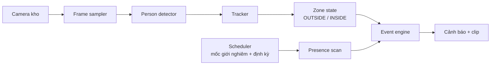
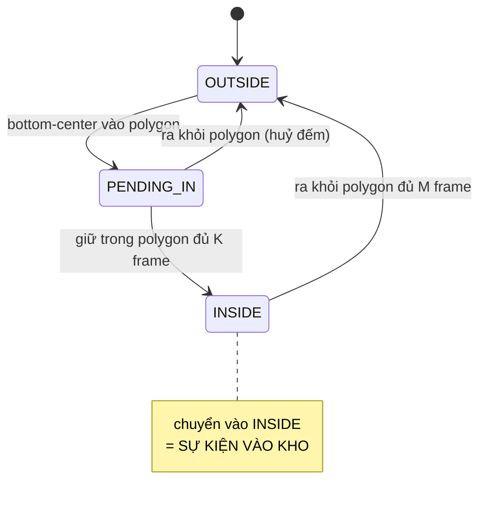

# Bài toán 3 — Phát hiện xâm phạm kho ngoài giờ quy định

Tài liệu mô tả bài toán, phạm vi POC và thiết kế luật cảnh báo.

**Phiên bản 1.0 — 08/2026.** Tài liệu này chỉ mô tả Bài toán 3. Tầng perception dùng
chung (person detection, tracking, frame sampling, event engine) được đặc tả chi tiết ở
`01_quay_thu_ngan.md`; ở đây chỉ trình bày ở mức tổng quan cùng những chỗ khác biệt.

---

## 1. Nghiệp vụ

Kho hàng chỉ được phép ra vào trong những khung giờ quy định — nhân viên vào để fill
hàng, bỏ hàng, kiểm kê. Ngoài khung giờ đó, bất kỳ ai có mặt trong kho đều là bất
thường và cần báo cho chủ cửa hàng kiểm tra.

Hệ thống phát hiện hai tình huống:

| Tình huống | Mô tả | Cách phát hiện |
|---|---|---|
| **Vào kho ngoài giờ** | Có người bước vào kho khi đang trong khung giới nghiêm | Sự kiện băng vào zone |
| **Ở lại quá giờ** | Người vào hợp lệ nhưng vẫn còn trong kho khi khung giới nghiêm bắt đầu | Quét hiện diện tại mốc chuyển giờ |

Đầu ra là cảnh báo kèm clip 15–30 giây quanh thời điểm, phục vụ human review. Hệ thống
không tự kết luận vi phạm.

## 2. Phạm vi POC

Bản POC **chỉ làm phần lõi**: phát hiện có người vào kho và có người trong kho.

| Trong phạm vi | Ngoài phạm vi (hoãn) |
|---|---|
| Person detection + tracking | Face detection |
| Zone kho, sự kiện vào/ra | Face embedding, gallery nhân viên |
| Quét hiện diện theo lịch | Định danh "ai đang trong kho" |
| Luật cảnh báo + chống trùng | Whitelist người được miễn trừ |
| Clip bằng chứng | Khung giờ riêng theo người/vai trò |

Nhánh định danh được thiết kế sao cho **thêm vào sau không phải sửa luật**: identity chỉ
là thuộc tính đính kèm cảnh báo, không tham gia quyết định bắn hay không bắn. Xem
[mục 9](#9-phần-hoãn-lại-định-danh-nhân-viên).

Các tham số nghiệp vụ (khung giờ cụ thể, độ dài cooldown) chưa chốt; tài liệu dùng giá
trị khởi điểm và đặt tất cả trong config để đổi không cần sửa mã.

## 3. Kiến trúc



### 3.1. Phần dùng chung với Bài toán 1 và 2

Ba mô-đun dưới đây **dùng lại nguyên vẹn**, không sửa đổi. Đặc tả đầy đủ nằm ở
`01_quay_thu_ngan.md`, mục tương ứng:

| Mô-đun | Vai trò ở bài này | Đặc tả chi tiết |
|---|---|---|
| `FrameSampler` | Đọc RTSP, downsample 5–10 FPS, drop khi backpressure | doc 01, mục 4.1 |
| `PersonPoseDetector` | Chỉ dùng person bounding box; **không dùng keypoints** | doc 01, mục 4.2 |
| `MultiObjectTracker` | Giữ Track ID qua các frame, Kalman dự đoán khi miss | doc 01, mục 4.2 + Phụ lục C |
| `TemporalStateCache` | Xác nhận trạng thái qua K frame trước khi tin | doc 01, mục 4.5 |
| Event engine | Vòng đời sự kiện, chống cảnh báo lặp | doc 01, mục 8 |

Hai điểm đáng chú ý về việc dùng lại:

**Bài này không cần pose.** Chỉ dùng bounding box. Nên nó **không bị chặn** bởi vấn đề
chất lượng keypoint ở góc top-view đang chặn Bài toán 2 (doc 01, mục 11.2). Có thể triển
khai song song.

**Tracker giữ nguyên mô hình định danh.** Track mất quá `max_age` thì bị REMOVED và ID
không quay lại; người xuất hiện lại là track mới. Không có re-identification gallery.
Thiết kế luật cảnh báo dưới đây được xây để **chịu được** việc đó — Track ID không bao
giờ được dùng làm khoá chống trùng.

### 3.2. Nhiều camera

Kho có 2–3 luồng camera, góc nhìn khác nhau (top-view và ngang hơi cao). **Mỗi camera là
một pipeline nghiệp vụ độc lập**: tự giữ zone, tự giữ cooldown, tự bắn cảnh báo. Một
người vào kho mà cả 3 camera thấy thì ra 3 luồng cảnh báo.

Đây là lựa chọn có chủ ý, đúng nguyên tắc cô lập theo camera ở doc 01 mục 3. Hệ quả cần
chấp nhận: chủ cửa hàng nhận nhiều cảnh báo cho một lần xâm phạm. Nếu sau này thấy phiền
thì gộp ở **tầng thông báo**, không sửa pipeline.

## 4. Zone kho

Camera cố định nên vùng kho xác định được sẵn và **hard-code trong config** dưới dạng
polygon toạ độ chuẩn hoá 0–1, giống `drawer_roi_norm` ở doc 01 mục 9.1. Không cần
calibration tự động.

Nên vẽ polygon phủ **toàn bộ sàn kho**, không phải một vạch hẹp ở cửa. Lý do: polygon
rộng chịu được miss detection tốt hơn nhiều. Một vạch hẹp đòi hỏi track phải có điểm ở
cả hai phía đúng vào lúc băng qua — mà ngay cửa là chỗ tệ nhất để trông chờ điều đó
(khung cửa che, ánh sáng đổi đột ngột, người đi nhanh). Hụt vài frame ở cửa là mất trắng
cả sự kiện. Với polygon rộng, người đã vào thì vẫn ở trong, bắt được ở frame nào cũng đủ.

Điểm tham chiếu của mỗi track là **bottom-center của person bbox**, thống nhất với cách
gán zone employee/customer ở doc 01 mục 4.3.

## 5. Xác định sự kiện vào kho

Mỗi track giữ một trạng thái zone riêng:



```
mỗi frame, với mỗi track:
    p = bottom_center(track.bbox)
    inside = point_in_polygon(p, zone_kho_norm)

    OUTSIDE    + inside                  -> PENDING_IN, bắt đầu đếm
    PENDING_IN + inside K frame liên tiếp -> INSIDE   ⇒ phát sinh SỰ KIỆN VÀO
    PENDING_IN + không inside            -> OUTSIDE, huỷ đếm
    INSIDE     + không inside M frame     -> OUTSIDE
```

**Ngưỡng vào và ra không đối xứng.** Vào cần xác nhận chặt (`entry_confirmation`, khởi
điểm 2–3 giây), ra thì nới hơn. Nếu để bằng nhau, người đứng ngay mép polygon sẽ làm
bbox rung vài pixel mỗi frame và sinh chuỗi in/out/in/out liên tục. Việc xác nhận 2–3
giây chỉ **làm trễ** cảnh báo, không làm mất — người đã vào thì vẫn còn ở đó.

**Ca dễ sót: track sinh ra khi đã ở trong zone.** Người xuất hiện giữa kho do detector
hụt ở cửa, vào từ góc khuất, hoặc hệ thống vừa khởi động lại. Track đó không có chuyển
tiếp OUTSIDE→INSIDE nào cả. Nếu chỉ bắt chuyển tiếp thì mất hẳn sự kiện. Xử lý: một track
**sinh ra bên trong polygon** và trụ đủ K frame cũng tính là một sự kiện vào. Cùng tinh
thần với cờ `was_in_frame` trong tracker (doc 01, Phụ lục C).

## 6. Quét hiện diện theo lịch

Sự kiện vào kho không phủ được hai tình huống:

1. **Ở lại quá giờ** — người vào hợp lệ lúc 07:59, vẫn ở trong kho lúc 08:30. Cú băng
   vào zone đã xảy ra trong khung giờ hợp lệ, không có sự kiện nào để bắn.
2. **Cú vào bị hụt** — detector miss ngay lúc người bước vào, hoặc hệ thống restart giữa
   khung giới nghiêm. Người ở trong kho cả đêm mà không trigger gì.

Cả hai được phủ bằng cùng một cơ chế: **quét hiện diện do đồng hồ đẩy**, không do frame
đẩy.

```
tại mốc bắt đầu khung giới nghiêm:   chạy quét
trong suốt khung giới nghiêm:        chạy quét mỗi scan_interval (khởi điểm 15 phút)

quét = trong scan_window (khởi điểm 20 giây):
         detect person trên toàn khung hình
         nếu xác nhận có người qua K frame -> phát sinh SỰ KIỆN CÓ MẶT
```

**Quét phải là một cửa sổ ngắn, không phải một frame.** Đây là điểm quan trọng nhất của
mục này. Đo đạc trên footage thật cho thấy detector ở góc top-view bỏ sót rất nhiều
người (doc 01, mục 11.2). Quét đúng một frame thì xác suất hụt cao — người vẫn đang
trong kho mà hệ thống kết luận trống. Quét 20 giây với xác nhận K frame vẫn rẻ nhưng độ
tin cậy khác hẳn.

## 7. Luật cảnh báo

### 7.1. Cooldown theo camera

Kho là nơi người ta ra vào liên tục — bê thùng vào, quay ra lấy thùng tiếp. Nếu mỗi sự
kiện vào đều bắn cảnh báo thì một lần fill hàng sinh hàng chục thông báo.

Mỗi camera giữ **một đồng hồ cooldown** (khởi điểm 10 phút), phủ **cả hai** loại sự kiện
(vào zone và quét hiện diện) để chúng không bắn chồng lên nhau.

Cooldown đếm từ **lần cảnh báo gần nhất đã gửi**, không reset bởi các sự kiện bị nuốt.
Điểm này quan trọng: nếu reset theo mỗi sự kiện thì một người ra vào đều đặn mỗi 9 phút
sẽ khoá cảnh báo vĩnh viễn.

### 7.2. Luật high-water: nhiều người phải phá được cooldown

Cooldown thuần sẽ nuốt mất người thứ hai: A vào lúc 20:00 (có cảnh báo), B vào lúc 20:05
thì bị nuốt — trong khi đó là một người khác và đáng lẽ phải báo.

Không thể dùng Track ID làm khoá để phân biệt, vì Track ID đổi liên tục khi người bị
khuất (doc 01, Phụ lục C) và sẽ sinh đúng cái spam mà cooldown đang chống.

Tín hiệu đáng tin hơn và thuần hình học: **số người đồng thời ở trong zone**.

```
high_water = số người trong zone cao nhất đã từng được cảnh báo trong cửa sổ cooldown

khi có SỰ KIỆN VÀO:
    n = số track đang ở trạng thái INSIDE
    nếu n > high_water:
        BẮN CẢNH BÁO
        high_water = n
    ngược lại:
        nuốt

khi cooldown hết:  high_water = 0
```

Người thứ hai, thứ ba **luôn xuyên qua được cooldown**, trong khi cùng một người ra vào
nhiều lần thì không — vì ra vào chỉ làm `n` dao động 0↔1, không bao giờ vượt mức đã báo.

### 7.3. Luồng ví dụ

Giới nghiêm bắt đầu 20:00, cooldown 10 phút, quét định kỳ 15 phút:

```
19:55  NV vào kho                    trong giờ cho phép      -> im lặng

20:00  ⏰ MỐC GIỚI NGHIÊM
       quét 20 giây -> còn người
       -> CẢNH BÁO #1  "còn người trong kho lúc giới nghiêm"
       -> cooldown tới 20:10,  high_water = 1

20:03  ra khỏi zone (bê hàng ra xe)   n: 1 -> 0
20:04  vào lại                        n: 0 -> 1   1 > 1 ? không  -> nuốt
20:06  ra                             n: 1 -> 0
20:07  vào lại                        n: 0 -> 1                  -> nuốt
                                      (4 lần ra vào, 0 cảnh báo thừa)

20:08  người thứ hai vào, người thứ nhất còn trong kho
                                      n: 1 -> 2   2 > 1         -> CẢNH BÁO #2
                                      high_water = 2

20:10  cooldown hết -> high_water = 0
20:15  ⏰ quét định kỳ -> vẫn có người  -> CẢNH BÁO #3, cooldown tới 20:25

20:22  tất cả ra hẳn
20:30  ⏰ quét định kỳ -> không có ai   -> im lặng

21:30  người lạ băng vào zone, ngoài cooldown -> CẢNH BÁO #4
```

### 7.4. Đánh đổi được chấp nhận

Còn đúng một trường hợp lọt: **A ra hẳn khỏi kho, B vào ngay sau đó, trong cùng cửa sổ
cooldown**. Số người trong zone không bao giờ vượt 1, nên hình học không phân biệt được
hai người. Không có bằng chứng dương tính nào nói đó là người mới.

Chấp nhận được vì: cooldown 10 phút rồi cũng hết và lần quét định kỳ tiếp theo sẽ bắt
được; clip bằng chứng vẫn được lưu; và khi thêm nhánh định danh
([mục 9](#9-phần-hoãn-lại-định-danh-nhân-viên)) thì face sẽ phủ nốt ca này.

### 7.5. Ưu tiên precision, ngược với Bài toán 1 và 2

Doc 01 mục 10 ghi nguyên tắc "ưu tiên recall theo nghiệp vụ" cho bài toán ở quầy. **Bài
này ngược lại**, và cần ghi rõ để không tune nhầm:

- **Bỏ sót ít nguy hiểm.** Người ở trong kho vài phút; chỉ cần bắt được ở một số frame là
  đủ, không cần frame nào cụ thể. Quét định kỳ là lưới an toàn thứ hai.
- **Báo nhầm rất đắt.** Một cảnh báo rác lúc 3 giờ sáng gửi thẳng cho chủ cửa hàng. Vài
  lần như thế là họ tắt hệ thống, và toàn bộ giá trị mất theo.

Trong kho lại có thùng hàng, giá kệ, hình in trên bao bì — đủ thứ sinh detection giả. Nên
ngưỡng confidence đặt cao hơn ở quầy, và xác nhận K frame là bắt buộc, không phải tuỳ chọn.

## 8. Định dạng dữ liệu

### 8.1. Config

```json
{
  "room_id": "kho_1",
  "timezone": "Asia/Ho_Chi_Minh",
  "allowed_windows": [["06:00", "08:00"], ["17:00", "18:30"]],
  "cooldown_s": 600,
  "scan_interval_s": 900,
  "scan_window_s": 20,
  "entry_confirmation_s": 2.5,
  "exit_confirmation_s": 4.0,
  "presence_confirmation_frames": 3,
  "person_conf_threshold": 0.5,
  "evidence_pre_s": 8,
  "evidence_post_s": 12,
  "cameras": [
    {
      "camera_id": "kho_cam1",
      "stream_url": "rtsp://...",
      "target_fps": 10,
      "zone_norm": [[0.08, 0.22], [0.94, 0.20], [0.96, 0.93], [0.05, 0.95]]
    },
    {
      "camera_id": "kho_cam2",
      "stream_url": "rtsp://...",
      "target_fps": 10,
      "zone_norm": [[0.02, 0.30], [0.88, 0.28], [0.90, 0.97], [0.03, 0.98]]
    }
  ]
}
```

`allowed_windows` áp dụng cho **tất cả mọi người và mọi ngày** — POC không có ngoại lệ,
không phân biệt cuối tuần hay ngày lễ. Để dạng mảng theo `room_id` nên sau này tách theo
vai trò hoặc theo ngày chỉ là thêm khoá, không phải viết lại.

### 8.2. Cảnh báo

```json
{
  "event_id": "KHO1_20260805_000042",
  "room_id": "kho_1",
  "camera_id": "kho_cam1",
  "event_type": "WAREHOUSE_INTRUSION",
  "trigger": "zone_entry",
  "severity": "high",
  "start_time": "2026-08-05T21:30:04.220+07:00",
  "end_time": "2026-08-05T21:30:26.880+07:00",
  "persons_in_zone": 1,
  "track_ids": [14],
  "identity": null,
  "reason_codes": ["OUTSIDE_ALLOWED_WINDOW", "ZONE_ENTRY_CONFIRMED"],
  "clip_uri": "s3://evidence/...mp4"
}
```

`trigger` nhận một trong `zone_entry` | `curfew_scan` | `periodic_scan`.

`identity` để `null` trong POC; trường được giữ sẵn trong schema để nhánh định danh gắn
vào sau mà không phải đổi hợp đồng dữ liệu.

## 9. Phần hoãn lại: định danh nhân viên

Ghi lại ở đây để bản sau không phải thiết kế lại từ đầu.

Ý tưởng: thêm nhánh face vào pipeline — **crop person bbox rồi mới đưa qua face
detector**, không chạy detect mặt trên cả khung hình. Hai lý do:

1. **Độ phân giải.** Mặt người trong kho trên ảnh 1920×1080 chỉ khoảng 30×30 px; đưa cả
   frame qua detector ở 640×640 là downsample 3×, mặt còn ~10×10 px và gần như chắc chắn
   miss. Crop người ra rồi resize lên input thì mặt được phóng to lên hàng trăm pixel.
2. **Liên kết face ↔ track là cấu trúc.** Mặt tìm được trong crop của track nào thì thuộc
   track đó theo định nghĩa — không phải ghép lại bằng khoảng cách bbox, vốn là cái bẫy đã
   gặp với keypoints ở doc 01 mục 4.2.1.

Luồng dự kiến: `person crop → face detect (kèm 5 landmark) → cửa lọc chất lượng → align
112×112 → embedding → so gallery`. So khớp cần **hai** điều kiện, không phải một:
`top1 >= ngưỡng` **và** `(top1 - top2) >= margin`; không đạt margin thì trả `unknown` chứ
không đoán, vì ghi sai tên nhân viên vào cảnh báo tệ hơn hẳn ghi `unknown`.

Khi có identity, nó bổ sung **điều kiện thứ ba** phá cooldown, bên cạnh đồng hồ và
high-water: một identity chưa từng được cảnh báo trong cửa sổ hiện tại thì bắn. Điều này
phủ nốt trường hợp lọt ở [7.4](#74-đánh-đổi-được-chấp-nhận). Luật hiện có **không phải
sửa** — chỉ thêm một vế `hoặc`.

Còn phải chốt trước khi làm: model face detect có nhánh landmark hay không (không có thì
không align được), model embedding, quy mô và quy trình cập nhật gallery, và quan trọng
nhất là **camera nào thực sự bắt được mặt** — cần đo trên footage thật thay vì giả định.

## 10. Xử lý các trường hợp biên

| Tình huống | Cách xử lý | Nguyên tắc |
|---|---|---|
| Miss person vài frame | Giữ Track ID và box dự đoán từ Kalman; trạng thái zone không đổi | Prediction duy trì trạng thái, không tạo sự kiện vào mới |
| Track đổi ID khi bị khuất | Không ảnh hưởng — Track ID không phải khoá chống trùng | Cooldown theo camera, phân biệt người bằng high-water |
| Người đứng ngay mép polygon | Ngưỡng vào/ra không đối xứng + xác nhận K frame | Chống rung in/out |
| Track sinh ra khi đã trong zone | Trụ đủ K frame thì tính là sự kiện vào | Không mất người vào từ góc khuất |
| Hệ thống restart giữa khung giới nghiêm | Quét định kỳ sẽ bắt được ở lần chạy kế tiếp | Quét là lưới an toàn cho mọi cú vào bị hụt |
| Detection giả trên thùng hàng/giá kệ | Ngưỡng conf cao + xác nhận K frame | Ưu tiên precision |
| Nhiều camera cùng thấy một người | Mỗi camera bắn cảnh báo riêng | Camera độc lập; gộp ở tầng thông báo nếu cần |
| Người vào hợp lệ rồi ở quá giờ | Quét tại mốc chuyển khung giờ | Trigger đến từ đồng hồ, không từ frame |

## 11. Đánh giá và lộ trình

### 11.1. Chỉ số

| Nhóm | Chỉ số |
|---|---|
| Perception | Person recall trong vùng kho, tỉ lệ false positive mỗi camera-giờ |
| Sự kiện | Tỉ lệ bắt được lần vào thật, tỉ lệ bắt được ca ở quá giờ |
| Cảnh báo | Số cảnh báo trùng cho một lần xâm phạm, số cảnh báo rác mỗi đêm |
| Hệ thống | FPS, latency, uptime, độ đầy đủ của clip |
| Nghiệp vụ | Tỉ lệ cảnh báo được chủ cửa hàng xác nhận là đúng |

Chỉ số quan trọng nhất giai đoạn đầu là **số cảnh báo rác mỗi đêm**. Nếu con số đó không
gần 0 thì hệ thống sẽ bị tắt, bất kể recall tốt đến đâu.

### 11.2. Lộ trình

| Giai đoạn | Phạm vi |
|---|---|
| Phase 1 | Zone + sự kiện vào, chạy trên footage kho có sẵn để tune ngưỡng |
| Phase 2 | Quét theo lịch, luật cooldown + high-water |
| Phase 3 | Clip bằng chứng, kênh gửi cảnh báo |
| Phase 4 | Chạy thật vài đêm, đo cảnh báo rác, tune lại ngưỡng |
| Phase 5 | Thêm nhánh định danh ([mục 9](#9-phần-hoãn-lại-định-danh-nhân-viên)) |

### 11.3. Việc còn tồn

- Chưa có footage kho để tune ngưỡng và kiểm chứng detector hoạt động thế nào ở góc
  camera thực tế.
- Khung giờ cụ thể, độ dài cooldown và chu kỳ quét là tham số nghiệp vụ, chưa chốt.
- Chưa xác định camera nào nhìn thấy cửa kho — ảnh hưởng tới việc vẽ polygon và tới nhánh
  định danh sau này.

---

## Phụ lục A. Tham số khởi điểm

| Tham số | Giá trị khởi điểm | Ghi chú |
|---|---|---|
| `entry_confirmation` | 2–3 s | Xác nhận đã vào zone; chống rung ở mép |
| `exit_confirmation` | 3–5 s | Nới hơn ngưỡng vào, không đối xứng |
| `cooldown` | 10 phút | Chống spam khi ra vào liên tục |
| `scan_interval` | 15 phút | Chu kỳ quét trong khung giới nghiêm |
| `scan_window` | 20 s | Độ dài mỗi lần quét; **không được là một frame** |
| `presence_confirmation` | 3 frame | Xác nhận có người trong lúc quét |
| `person_conf_threshold` | 0.5 | Cao hơn ở quầy, vì ưu tiên precision |
| `evidence_pre / post` | 8 s / 12 s | Tổng clip 15–30 s |

Tất cả là giá trị khởi điểm, cần tune trên footage kho thật theo góc camera và theo mức
chấp nhận cảnh báo rác của chủ cửa hàng.
